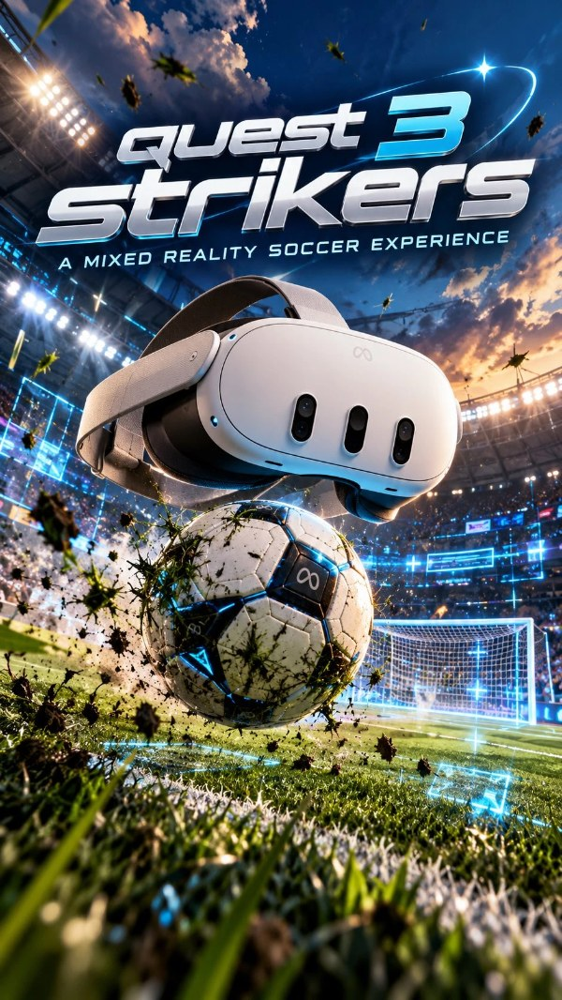

# Quest 3 Strikers

<p align="center"></p>

Super Mario Strikers (GameCube), running natively on a Meta Quest 3 as a mixed-reality app. Not an
emulator: the game is built from the community decompilation, compiled for the headset's ARM chip,
and drawn straight into your room through OpenXR.

This is a fork of [`luisxl15/Strikers-Android-Port`](https://github.com/luisxl15/Strikers-Android-Port),
the Android phone port, with a Quest layer on top.

*You need your own copy of the game. **No game files are included**, in this repository or in the
APK.*

### [⬇ Download the latest version](https://github.com/LanceSweatpants/Strikers-Quest-MR/releases/latest)

On that page, under **Assets**, get the file ending in **`.apk`** (not "Source code"). Then follow
[How to install](#how-to-install-easy-version).

## What it is

Four ways to watch the same match, switched any time by clicking the controller sticks (see
[Controls](#controls-quest-3-controllers)):

- **Jumbotron · Living Room**: a big flat screen floating in your real room (passthrough), in three
  sizes. This is where the game starts.
- **Jumbotron · Stadium**: the same screen, but you stand on the pitch of a life-size stadium, the
  one your match is being played in.
- **Tabletop · Living Room**: the match as a miniature 3D pitch in your room, like a foosball table
  with the electric fence for walls. Put it on a real table, the bed or the floor, walk around it,
  grab it, turn it and resize it with your hands. The players are drawn a bit bigger so they read at
  table size, an arrow floats over the player you control, and a small score board hangs over the
  field.
- **Tabletop · Stadium**: the table inside the life-size stadium, with the stands all the way around
  you.

And around the game:

- **Goal celebrations in 3D**: confetti in the scorer's colours plus their own piece (coins for
  Mario, hearts for Peach, bananas for Donkey Kong, and so on), confetti cannons, streamers, foil,
  pyro and fireworks, landing on your floor and on the table. In the Tabletop modes the goal replay
  plays on a jumbotron that drops from the ceiling (or the sky, in the stadium). Skip the replay and
  it all stops.
- **The game's own white flashes** (replay wipes, the Super Strike flash) light up your whole view,
  not just the picture.
- **Controller rumble**: the game's rumble reaches the Touch controllers, with an extra buzz on your
  goals.
- **Online 1v1 with room codes**: one player hosts and reads out a four-letter code, the other types
  it in. Each player keeps their own view mode.
- **Your disc image as it is**: `.iso`, or Dolphin's `.rvz` and `.wia` with any compression. Pick
  it with **Choose game file**, which also tells you if a file isn't the right game.
- **Updates from inside the app**: when there's a new version, the first screen offers **Update
  now**.

## Status

**Free alpha.** Tested on Quest 3, including online matches between two Quest 3 headsets. Every
other headset is untested: the Quest 3S has the same chip and should behave the same, but nobody
has tried it yet. Expect rough edges, and see [Known issues](#known-issues).

## How to install (easy version)

> **Already have it?** On alpha 1.2 or newer: open the app and press **Update now**.
> On alpha 1 or 1.1: just do **Step 3** below, once.

**You need:**
- A **Meta Quest 3** and a **USB-C cable**
- A **PC**
- **Your own** Super Mario Strikers (GameCube) game file: **`.iso`**, **`.rvz`** or **`.wia`**

### Step 1 · Developer Mode *(only once)*
1. On your phone, open the **Meta Horizon** app.
2. **Devices** → your Quest → **Headset settings** → **Developer mode** → **On**.
   *(Asked to make a free developer account? Do it, then come back.)*
3. Restart the Quest.

### Step 2 · SideQuest *(only once)*
1. On your PC, install the free [**SideQuest Advanced Installer**](https://sidequestvr.com/setup-howto) and open it.
2. Plug the Quest into the PC.
3. Put the Quest on. At **"Allow USB debugging?"** tick **Always allow** and press **Allow**.
4. The dot at the top left of SideQuest turns **green**. You're connected.

### Step 3 · The app
1. [**Download the `.apk`**](../../releases/latest): under **Assets**, the file ending in `.apk`.
2. Drag it onto the SideQuest window. Wait until it says it's done.

### Step 4 · Your game file
1. In SideQuest, click the **folder icon** at the top.
2. Open **Download**.
3. Drag your `.iso`, `.rvz` or `.wia` in. *(Zipped? Unzip it first.)*

### Step 5 · Play
1. Unplug the Quest and put it on.
2. **Library** → **All** (top right) → **Unknown Sources** → **Quest 3 Strikers**.
3. Press **Play offline**.
4. **First time only:** turn on **"Allow access to manage all files"**, go back, and press
   **Play offline** again.

- **Game not found?** Press **Choose game file** and tap yours.
- **Next time?** Just Step 5.
- **New version out?** The app shows **Update now**. Press it, then **Install**. *(The first time,
  allow the app to install updates.)* Your saves and game file stay.

Now see [Controls](#controls-quest-3-controllers) to switch to the tabletop and the stadium.

## Controls (Quest 3 controllers)

### Playing

| Button | What it does |
| --- | --- |
| **Left stick** | Move |
| **A** | Pass |
| **B** | Shoot |
| **X** | Use your item |
| **Y** | Hit |
| **Right grip** (squeeze) | Swap items |
| **Left / right trigger** | The GameCube's L / R |
| **Right stick** | The GameCube's C-stick |
| **Menu button** (left controller, ☰) | Pause |

### Switching views

"Click" a stick means **press it straight down** like a button. Switching needs **two quick
clicks**, so you can't do it by accident mid-match.

| Do this | What happens |
| --- | --- |
| **Left stick: click twice fast** | Swap between **your room** (mixed reality, you see your real room) and **the stadium** (full VR, you're standing on the pitch) |
| **Right stick: click twice fast** | Swap between the **big screen** and the **tabletop** (a mini 3D pitch you can walk around) |
| **Right stick: click once** | Big screen: change its size (3 sizes) |
| **Left stick: click once** | Tabletop: bring the table back in front of you |

So there are four views, and you can mix them any way you like:

| | Big screen | Tabletop |
| --- | --- | --- |
| **Your room** (MR) | Where the game starts: a giant screen floating in your room | The mini pitch on your real table, bed or floor |
| **Stadium** (VR) | The screen, with you standing in the stadium | The mini pitch, with the whole stadium around you |

### Moving the table (Tabletop)

- **Grab it:** hold the **left grip** and move your hand. The table follows, up and down too. Let
  go to drop it there.
- **Make it bigger or smaller, or turn it:** keep holding the left grip and push the **left
  stick** up/down to resize it and left/right to turn it. (While you hold the left grip, your
  player stands still: the stick is moving the table.)
- **With both hands:** hold the left grip, put your right hand on the table and squeeze the
  **right grip** too. Pull your hands apart or together to resize it, and twist them to turn it.
- **Right hand only:** squeeze the right grip with your hand on the table to grab it. Anywhere
  else, the right grip swaps items as usual.
- Lost the table? **Click the left stick once** and it comes back in front of you.

A Bluetooth gamepad paired to the headset also works for offline play.

## Play online with a friend

Both of you need the **same version** of the app, and your own game files.

1. **One of you hosts:** press **Host an online match**. You get a 4-letter code. Tell it to your
   friend, then press **Start**.
2. **The other joins:** press **Join with a code**, type the code, press **Join**.
3. **Both of you:** pick **Grudge Match** on the main menu, choose your teams and start. Whoever
   gets there first waits a moment on the loading screen. Then you're playing each other.

## If something goes wrong

- **SideQuest says "there's no apk in that file":** you downloaded "Source code". On the
  [Releases page](../../releases/latest), under **Assets**, download the file ending in **`.apk`**.
- **"Your game file wasn't found" / the app closes when you press Play** (alpha 1.1 and older):
  press **Choose game file**. It lists every `.iso`, `.rvz` and `.wia` on the headset and says what's
  wrong with any it can't use. If the list is empty, your game file isn't on the headset yet, or
  it's still inside a `.zip`/`.7z`: unzip it on your PC and do Step 4 again.
- **The menu keeps asking for file access:** in the settings screen, make sure the switch is on for
  **Quest 3 Strikers**.
- **The game closed:** open it again from Unknown Sources. If the game stopped because of a problem,
  the first screen shows its message.
- **Online, you ended up playing the computer:** back out to the main menu. Make sure you both
  used the same code, then both start Grudge Match again.
- **Still stuck?** [Report a bug](../../issues/new?template=bug_report.yml).

<details>
<summary>More detail: disc versions, file formats, where the game looks</summary>

- The US version (disc code `G4QE01`) is the tested one. The port also reads the European
  (`G4QP01`, sold as *Mario Smash Football*) and Japanese (`G4QJ01`) discs; those are untested on
  the headset.
- Formats: `.iso` (NKit too), and Dolphin's `.rvz` (zstd, bzip2, LZMA, LZMA2 or none) and `.wia`
  (purge, bzip2, LZMA, LZMA2 or none). Older `.gcm`, `.ciso` and `.gcz` files are still read if the
  game finds them by itself, but **Choose game file** lists only `.iso`, `.rvz` and `.wia`.
- Where the game looks for the disc: the file picked with **Choose game file**. With none picked, in
  order: a folder called `Strikers` at the top of the headset's storage (the game creates it, and
  keeps its settings and log there), then the top of the storage itself, `Games/Strikers`,
  `ROMs/GameCube` and `Download`. If a folder holds several GameCube disc images, the game takes the
  one whose name comes first alphabetically.
- The first screen asks GitHub once each time it opens whether there's a newer release (nothing
  else is sent). Offline, it just doesn't show **Update now**.
- Instead of SideQuest you can use `adb install` and `adb push`, or the headset's own USB file
  access (allow it inside the headset, and it shows up on the PC as a drive).
- Hand tracking is not supported; use the Touch controllers.

</details>

More about online play:

- Start your Grudge Match only once both of you are in the game with the code. If your friend is
  not in the room yet, your match starts offline straight away; back out and start again. If they
  never start one, yours goes offline after three minutes.
- One headset is picked automatically as the home side, and its stadium and match settings are
  used.
- Each player has their own view: one can play on the table while the other plays on the big
  screen.
- If the connection is lost for about ten seconds, the online match ends. Go back to the menu and
  start a new Grudge Match.
- A room code is not a password: anyone who types the same code lands in the same room. While two
  players are playing, a third headset in the room is ignored. Join also takes your own made-up
  code (3 to 8 letters or numbers), as long as you both type the same one.
- The connection goes through a small free relay (see [The room server](#the-room-server)). It only
  passes game messages along (button presses and team picks) and stores nothing. Like any web
  service, its host sees your IP address.


## Known issues

- **The Stadium modes run below the headset's refresh rate**, at roughly 40 to 48 frames a second.
  The Jumbotron in your room and Tabletop · Living Room run at full speed. Offline, the game itself
  still runs at its normal speed.
- **Online, the slower headset sets the pace for both.** A headset that can't keep up in a 3D mode
  redraws its 3D view every other frame for the rest of that match.
- **Online uses the Touch controllers only.** A Bluetooth gamepad's buttons are not sent to your
  friend, so don't use one in an online match.
- **Both players need the same release of the app.** With different versions the two headsets
  ignore each other and each plays offline. Players on different disc regions are untested.
- **The game's video clips don't play** (the intro and attract movies): this build has no video
  decoder. Everything else runs without them.
- **Don't open the app from the Library during a match.** The panel comes up in front of the game
  and pauses it; online, your friend's headset ends the match after about ten seconds. Use the
  Quest menu to quit, then open the app again.
- **The shared room server runs on Cloudflare's free plan.** If it hits the free daily limit,
  online play won't connect until the limit resets (00:00 UTC). Offline play is not affected.

To report a problem, the game's log is `Strikers/strikers-log.txt` on the headset's storage.

## Building from source

Most players don't need this. The build is two steps: CMake and the Android NDK build the game,
then Gradle packages it.

You need:

- The Android SDK with NDK **29.0.14206865** (the one Aurora's prebuilt Dawn is built with),
  `platforms;android-35`, `build-tools;35.0.1` and `cmake;3.31.6` (which also brings Ninja).
- JDK 17, Python 3 and a POSIX shell (on Windows, Git Bash).
- An internet connection the first time: CMake downloads SDL3, Aurora's prebuilt Dawn and a few
  smaller libraries, and Gradle downloads itself.
- The Khronos OpenXR loader for Android, **1.1.63**
  ([`openxr_loader_for_android-1.1.63.aar`](https://repo1.maven.org/maven2/org/khronos/openxr/openxr_loader_for_android/1.1.63/)
  on Maven Central), unpacked into a folder with `include/openxr/*.h` and
  `lib/arm64-v8a/libopenxr_loader.so`. Point `STRIKERS_OPENXR_ROOT` at that folder.

```sh
sdkmanager "ndk;29.0.14206865" "platforms;android-35" "build-tools;35.0.1" "cmake;3.31.6"

# The OpenXR loader: an .aar is a zip.
export STRIKERS_OPENXR_ROOT="$HOME/openxr"
mkdir -p "$STRIKERS_OPENXR_ROOT/include" "$STRIKERS_OPENXR_ROOT/lib/arm64-v8a"
unzip -q openxr_loader_for_android-1.1.63.aar -d openxr-aar
cp -r "$(dirname "$(find openxr-aar -path '*include/openxr/openxr.h' | head -1)")" \
      "$STRIKERS_OPENXR_ROOT/include/"
cp "$(find openxr-aar -path '*arm64-v8a*' -name libopenxr_loader.so | head -1)" \
   "$STRIKERS_OPENXR_ROOT/lib/arm64-v8a/"

# The game, then the app.
export ANDROID_SDK_ROOT="/path/to/android-sdk"
export PATH="$ANDROID_SDK_ROOT/cmake/3.31.6/bin:$PATH"
cd smstrikers-port
tools/build-android.sh                   # -> build-android/jniLibs/arm64-v8a/
cd android && ./gradlew assembleDebug    # -> app/build/outputs/apk/debug/app-debug.apk
```

Notes:

- `STRIKERS_OPENXR_ROOT` is read when the build is first configured. If you set it after a failed
  first try, delete `build-android/` and run the script again.
- The APK on the Releases page is this debug variant, signed with a development key. A build of
  your own is signed with your own key, so it won't install over that one without an uninstall
  first.
- `PYTHON` and `CMAKE` in the environment override `python3` and `cmake` if yours have other names.
- The celebration shaders are checked in already compiled (`src/platform/xr_fx_shaders.h`). Only if
  you change one under `src/platform/shaders/`, rebuild them with `tools/compile-xr-shaders.ps1`
  and the NDK's `glslc`.
- The Quest code lives in `src/platform/xr_quest.cpp` (OpenXR session, input, view modes),
  `xr_layers.cpp` (what goes on the table and what goes in the stadium), `xr_fx.cpp` (celebrations),
  `xr_net.cpp` with `android/.../NetWs.java` (online), and `android/.../LobbyActivity.java` (the
  panel). The phone port's notes are in
  [`smstrikers-port/README-android.md`](smstrikers-port/README-android.md).

## The room server

Online play goes through a tiny relay: a Cloudflare Worker with one Durable Object per room code,
which passes each message to everyone in the room. Its source is in [`server/`](server/), with
instructions to run your own copy on Cloudflare's free plan and point the game at it (one line,
`kServerHost` in `smstrikers-port/src/platform/xr_net.cpp`). Both players need builds that point at
the same server.

## Credits

- [Yannick Suter](https://github.com/yannicksuter) and contributors: the decompilation.
- [`new-coke/strikers`](https://github.com/new-coke/strikers): the native port this is built on.
- [`luisxl15/Strikers-Android-Port`](https://github.com/luisxl15/Strikers-Android-Port) (Luis
  Santos): the Android port this fork starts from.
- [encounter/aurora](https://github.com/encounter/aurora): GX/VI/PAD/CARD over WebGPU and SDL3.
- [JoeyAW/aurora-vr](https://github.com/JoeyAW/aurora-vr) and [JoeyAW/TPVR](https://github.com/JoeyAW/TPVR):
  the external render-pass and Vulkan/OpenXR hand-off that the headset path follows.
- [bylaws/libadrenotools](https://github.com/bylaws/libadrenotools): custom GPU driver loading,
  inherited from the Android port and still built in.
- [SDL](https://github.com/libsdl-org/SDL), [Dawn](https://dawn.googlesource.com/dawn),
  [zstd](https://github.com/facebook/zstd) (reads `.rvz`) and the
  [Khronos OpenXR loader](https://github.com/KhronosGroup/OpenXR-SDK).
- Button prompt artwork by [Kenney](https://www.kenney.nl) (CC0).
- Quest mixed-reality port and the Quest 3 Strikers art: [LanceSweatpants](https://github.com/LanceSweatpants).

## License

There is no single license for this repository. This is what applies, as far as it can be backed
up:

- **This fork's Quest additions** (the OpenXR layer, the celebrations, the online play and its room
  server in `server/`, the panel, and every other change on top of `luisxl15/Strikers-Android-Port`)
  are free software under the **GNU General Public License, version 3 or (at your option) any later
  version**. The text is in [`LICENSE`](LICENSE). The `.rvz` reader in
  `smstrikers-port/src/platform/disc.c` follows Dolphin's code and is GPL-2.0-or-later, used here
  under GPLv3; GPLv3 is also what lets it sit in one binary with the Apache-2.0 and FreeType-licensed
  libraries the APK links.
- **Third-party code compiled into the APK** and the notices its licenses ask for are listed in
  [`THIRD-PARTY-NOTICES.md`](THIRD-PARTY-NOTICES.md).
- **The porting code, tools and docs from `new-coke/strikers`** are offered under CC0 1.0, as that
  project's README states. The text is in
  [`smstrikers-port/LICENSE-CC0.txt`](smstrikers-port/LICENSE-CC0.txt).
- **The reconstructed game code** (the decompilation) is an unofficial reconstruction. It may
  remain subject to third-party rights; no ownership of those is claimed, and none is granted here.
- **ODE physics** (`src/ode`, `include/ode`): ODE's BSD-style license
  ([`LICENSE-BSD.TXT`](smstrikers-port/LICENSE-BSD.TXT), and `src/ode/LICENSE` for what it covers).
  ODE's own headers also offer the LGPL 2.1, whose text is in
  [`LICENSE-LGPL-2.1.txt`](smstrikers-port/LICENSE-LGPL-2.1.txt).
- **`LICENSE-GPL-2.0.txt`** came with the upstream tree, which does not say which files it covers.
  zstd, below, offers the GPLv2 as one of its two options.
- **Bundled libraries**, each under its own file: Aurora (MIT, `extern/aurora/LICENSE`), MusyX (MIT,
  `extern/musyx/LICENSE`), zstd (BSD, `extern/zstd/LICENSE`), and Kenney's button prompts (CC0,
  `assets/input-prompts/LICENSE-Kenney.txt`). SDL3 (zlib), Dawn (BSD 3-Clause), libadrenotools
  (BSD 2-Clause), the OpenXR loader (Apache 2.0) and Aurora's other dependencies (abseil, fmt,
  FreeType, Dear ImGui, libpng, SQLite, xxHash) are downloaded at build time, each under its own
  license.
- **The Android port's own code** (`luisxl15/Strikers-Android-Port`) has no license stated by its
  author. It is included as published there, with credit above.

## Disclaimer

An unofficial project, not affiliated with or endorsed by Nintendo or Next Level Games. Super Mario
Strikers is a trademark of Nintendo. No game files are included in this repository or in the APK;
the game runs only from a disc image of your own, legally obtained copy.
